# OpenYAM collection and ACT loop

An experimental single-arm learning application operated in **DimOS Desktop**:
Quest demonstrations → saved episodes → ACT → rollout → human corrections → fine-tuning.
The Desktop app lives in its own repository. This directory owns the experiment session,
recording, model handoff and app worker; it contains no separate web interface.

## Ownership

```mermaid
flowchart LR
  Desktop[DimOS Desktop] --> Session[Session: authority + episode acceptance]
  Quest[Existing WebXR module] --> IK[Existing teleop IK task]
  Session --> Target[Shared trajectory task: persistent setpoints]
  ACT[Shared isolated LeRobot policy runtime] --> Coordinator
  IK --> Coordinator[ControlCoordinator]
  Target --> Coordinator
  Coordinator --> Device[Sim2 device or physical Damiao adapter]
  Device --> Sim[Sim2 workcell or configured physical station]
  Sim -->|joint feedback + accepted commands| Capture[Shared native CollectionRecorder]
  Sim -->|wrist RGB| Capture
  Sim -->|wrist RGB + joint positions| Session
  Session --> ACT
  Capture --> Selection[Saved human segments, train split, alignment checks]
  Selection --> Dataset[Immutable standard LeRobot dataset]
  Dataset --> Train[Official LeRobot ACT training]
  Train -->|weights + processors + contract + ancestry| ACT
```



The exported YAM artifact is the physical robot definition. `openyam/workcell.py`
adds the task scene and cameras. It preserves native position servos and the passive
finger reset contract; it does not import the RL trainer or add a second PD loop.
The existing coordinator owns task timing and arbitration. The shared `JointTrajectoryTask`
has an opt-in `hold_final_position` mode that retains the last commanded reference and
continues to emit the final target until authority changes. Ordinary finite trajectories
keep their existing default behavior. Re-executing finite trajectories here
would restart completed joints from gravity-deflected feedback and produce oscillation.
Takeover, task preemption and reset clear the reference before a new owner starts.
`YamPositionDevice` fences in-flight writes when authority changes and journals accepted
commands until their exact sequence is acknowledged by sim2.
The local hold task reseeds the existing OperatorHoldTask when its control tick observes
a new sim2 generation, preventing pre-reset position targets from surviving a reset.
Hold seeds are clamped to command limits because measured physical positions can
slightly overshoot them; one overtraveling finger must not invalidate the whole arm's hold.
The exported servos still exhibit static gravity deflection. Persistent setpoints remove
the command-induced shaking; they do not add gravity compensation or retune the model.

The session changes authority and submits manual targets. The shared LeRobot runtime
submits policy chunks directly to the coordinator. Cancellation generations reject delayed
submissions after takeover, including after a later resume. ACT steps that elapsed during
inference are skipped; the trajectory task retains its final commanded target between
chunks. Observation age is checked again after inference, before dispatch. Expired inputs,
an exhausted action horizon, reset or an operator Hold require
an explicit policy restart. Fresh Quest input can maintain the operator lease independently
of the Desktop page. This worker configures a unique loopback-only simulation namespace.

## Operate in Desktop

Prepare a normal DimOS worktree and its isolated trainer:

```sh
uv sync --extra all
uv sync --frozen --project native/python/lerobot
cd dimos/experimental/memory/rust
nix build
```

In the separate OpenYAM Workcell app's **Setup**, choose this checkout and the directory
containing the exported `contract.json`, `robot.xml` and assets. The artifact loader checks
its hashes and physical contract. The native recorder uses the existing DimOS Nix build;
a cold build can take substantial time. Provision it before an office collection session.
Changing Setup requires an idle experiment. Each app installation has its own data folder.

1. Select simulation or a physical station. Physical setup requires a station name, CAN
   interface (Linux) or adapter USB serial (macOS), and the RealSense camera serial.
   Connect opens the station with motors disabled. Check the wrist preview, then explicitly
   Enable arm; activation calibrates the gripper. Set a task instruction before collecting.
2. Start Quest teleop on an available port and open the displayed HTTPS address on the
   headset. Hold the right grip to move through the existing IK task; the trigger closes
   the gripper. Release holds. A starts/saves a **training** episode; B discards it. Wrist
   video and recording state appear in the headset. Desktop also offers joint controls.
3. Save useful episodes; discard the rest. Use Desktop's eval split for held-out collection.
4. Train ACT. The robot session stops while the training subprocess owns the job. Normal
   training uses ResNet18, a 512-dimensional transformer and 50-action chunks. A short
   run checks integration; the default 2,000 steps is a budget, not a success guarantee.
5. Load a completed checkpoint and wait for preflight. Run & record, then take over with the grip
   or joint controls. Saving accepts the human corrections. Fine-tune from that checkpoint
   using the expanded dataset. The official LeRobot trainer starts a fresh optimizer and
   uses the selected dataset's normalization statistics. Parent model identity is retained.
6. Download the policy bundle, then import it on a machine with the same station contract.
   Import verifies runtime file hashes; preflight still checks the live observations.

Opening the app alone starts an idle worker. Closing a session discards an unfinished
recording. Physical calibration and task reset remain operator actions. This version has
one seven-dimensional arm policy; neither bimanual nor leader/follower teleoperation is wired.

## Data and compatibility

Policy input is 320×180 wrist RGB plus seven joint positions at a nominal 20 Hz. It uses
the exported artifact's named `camera_d405`, preserving its mount, optical calibration
and 16:9 aspect ratio. This is model calibration; real camera extrinsics and hardware
gripper calibration still need measurement. Overview RGB and
scene geometry are operator views and never enter ACT. Arm actions are absolute public
joint positions in radians. In this artifact the public gripper coordinate increases
closure: 0..1 maps to left-finger displacement 0..0.0355 m. Older prototype coordinates
and checkpoints require an explicit migration and are rejected.

The shared Rust-backed CollectionRecorder writes typed `JointState`/`Image` MCAP channels, the shared
`CollectionProfile`/`RecordingSchema`, authority and reset generations, exact acknowledged
command sequences, dispatch timestamps, task/split/acceptance, and policy identity.
Sensor timestamps follow sim2's clock. Acknowledged action samples use that same clock;
original host dispatch time and command age remain separate provenance. They must not be
subtracted as if the two clocks were identical. Physical recordings identify driver-accepted
commands, not firmware-applied sequences. Station/camera identity is part of their contract,
so simulation checkpoints are not silently treated as compatible physical policies.
Save waits for recorder write receipts and finalized MCAP counts before publishing metadata.
Unfinalized files cannot enter training. Provenance segment times use the encoded sensor
timestamps so nanosecond quantization cannot discard a boundary frame.

Training selects finalized, saved **human/correction** segments in the train split.
Policy actions, holds, unacknowledged commands, discarded/partial recordings and evaluation
are excluded. Takeover, reset and camera gaps split episodes. Alignment checks reject bad
segments with reasons in the snapshot manifest. No interpolation across these boundaries
or silent quality relaxation occurs.

The frozen manifest hashes its MCAP/schema inputs. The isolated native LeRobot writer
creates a standard dataset with each accepted segment as an episode; official LeRobot
padding prevents ACT chunks crossing segment boundaries. The completed dataset has a file
manifest. Checkpoints include weights, processors, configuration, losses, dataset identity,
parent ancestry and a runtime file manifest. Loading/fine-tuning checks the artifact,
camera profile, joint order, action semantics, FPS, image shape and file hashes.

The former hand-written LeRobot parquet/video writer is replaced by the native dataset
API. Generic `run_dataprep` delegates LeRobot conversions to the locked environment; HDF5
and explicit-format CLI inspection remain supported. The earlier loop's NPZ handoff is gone.

Offline entry points, using a new output directory each time:

```sh
python -m dimos.imitation.loop snapshot /path/to/learning /path/to/snapshot
python -m dimos.imitation.loop train /path/to/snapshot /path/to/checkpoint --steps 2000 --device cpu
```

## Verification and extension

Behavior tests cover authority fencing across threads, acknowledgements/reset, stale
inference, delayed action steps, dataset selection and immutable inputs. Native tests
exercise official LeRobot encoding/loading and action padding at correction boundaries.
See `verification.json` for the recorded local integration run and its limits.

```sh
python -m pytest dimos/imitation/loop dimos/imitation/dataprep dimos/imitation/collection/test_profile.py dimos/imitation/collection/test_recording.py dimos/robot/manipulators/openyam/test_device.py dimos/robot/manipulators/openyam/test_simulation.py
uv run --frozen --project native/python/lerobot --group tests --with-editable . python -m pytest -c native/python/lerobot/pyproject.toml native/python/lerobot/dimos_lerobot/act_loop_tests.py native/python/lerobot/dimos_lerobot/dataprep_tests.py
```

This composes the CollectionRecorder, profile/schema and native export design from
`cc/feat/flexible-policy-module` at `fde4d8e047729de20cb2e4162e2b60698b5738bc`, the existing
coordinator/WebXR/IK stack, and the reusable sim2 YAM integration. It does not merge the
competing station recorders or add a second hardware control path. The physical boundary
uses the existing Damiao adapter and RealSense camera; its coordinate/acceptance behavior
has mock coverage, but real-arm operation still needs station calibration, teleoperation
and policy evaluations. RL, SONIC, bimanual stations, cloud training, semantic labeling and
policy chaining remain separate extensions.
